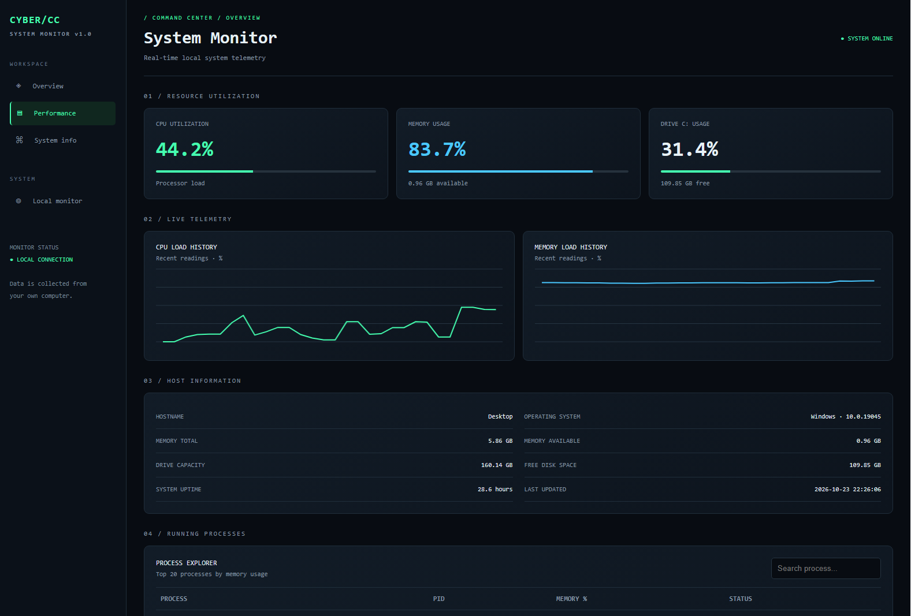

# Cyber Command Center

A local Windows system monitoring dashboard built with Python, Flask, and psutil.

## About

Cyber Command Center provides a simple dashboard for monitoring essential system resources on your own computer.

## Features

- Live CPU, RAM, and disk usage
- System information and uptime
- Running process overview
- Resource threshold alerts
- SQLite database for storing alert history
- Dark Arctic Blue dashboard theme

## Tech Stack

- Python
- Flask
- psutil
- SQLite
- HTML, CSS, and JavaScript

## Current Status

This project is under development. Features are being tested and improved.

## Privacy

The application is configured for local access at `127.0.0.1`. It is intended for monitoring your own computer. Do not expose the development server to the public internet without appropriate security changes.

## Roadmap

- Improve dashboard navigation and accessibility
- Test alert persistence and error handling
- Add setup instructions for Windows
- Prepare screenshots and a demo video

## Learning Project

Built as a hands-on project to learn Python, web development, and system monitoring.

## Dashboard Preview



## Installation on Windows

### Requirements

- Python 3.10 or newer
- Windows

### Setup

1. Clone or download this repository.
2. Open a terminal in the project folder.
3. Create a virtual environment:

   ```powershell
   python -m venv .venv
   ```

4. Activate the virtual environment:

   ```powershell
   .\.venv\Scripts\Activate.ps1
   ```

5. Install dependencies:

   ```powershell
   pip install -r requirements.txt
   ```

6. Start the application:

   ```powershell
   python app.py
   ```

7. Open `http://127.0.0.1:5000` in your browser.

### Notes

- The application is intended for local use on your own computer.
- Keep the terminal open while using the dashboard.
- Press `Ctrl + C` in the terminal to stop the server.